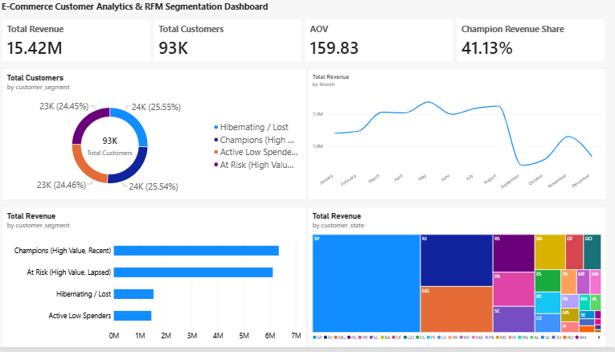

# E-Commerce Customer Analytics & RFM Segmentation

An end-to-end data analytics project using PostgreSQL, Python, and Power BI to find which customers drive the most revenue.

## Business Problem
An online store needs to know who its best customers are, who is about to leave, and where to focus marketing. This project groups customers using RFM analysis (Recency, Frequency, Monetary value) and shows the results in an interactive dashboard.

## Dataset
Brazilian E-Commerce Public Dataset by Olist (Kaggle): https://www.kaggle.com/datasets/olistbr/brazilian-ecommerce
About 100k orders from 2016-2018. All money values are in Brazilian Reais (R$).

## Key Results
- Total revenue analyzed: R$15.42M across 93,358 unique customers
- Average order value (AOV): R$159.83
- Champions are 41.1% of revenue, and Champions plus At Risk customers together bring 80.7% of revenue from about half of all customers
- 97.0% of customers ordered only once, so repeat purchase is the biggest opportunity
- 22,990 lapsed "Win-back Priority" customers hold R$6.12M (39.7% of revenue)
- Loyal Repeat Buyers are only 1.7% of customers but spend the most per customer (R$314.84 on average)

## Revenue by Segment
| Segment | Customers | Revenue (R$) | Share |
|---|---|---|---|
| Champions (High Value, Recent) | 23,845 | 6.34M | 41.1% |
| At Risk (High Value, Lapsed) | 22,826 | 6.11M | 39.6% |
| Hibernating / Lost | 23,852 | 1.53M | 9.9% |
| Active Low Spenders | 22,835 | 1.44M | 9.4% |

## Recommendations
- Run a win-back campaign for the At Risk / Win-back Priority group, the biggest pool of recoverable revenue
- Turn one-time buyers into repeat buyers, for example with a discount on the second order
- Reward the small group of Loyal Repeat Buyers, since they spend the most per customer
- Protect Champions with early access or loyalty perks

## Pipeline
1. PostgreSQL: loads raw customers, orders, and order items, and builds the view `v_customer_transactions` (delivered orders only)
2. Python (`customer_segmentation.py`): calculates RFM scores, assigns two segment sets (4 main segments and 5 detailed segments that also use frequency), builds revenue summary tables, and saves everything back to the database
3. Power BI: data model, DAX measures (AOV, Total Revenue, Champion Revenue Share) and an executive dashboard

## Project Structure
- `sql/` : table creation, data checks, and the transactions view
- `python/` : RFM segmentation script
- `dashboard/` : Power BI file (.pbix) and a PNG preview

## How to Run
1. Install PostgreSQL and create a database named `ecommerce_analytics`
2. Download the dataset from the Kaggle link above
3. Run the SQL files in the `sql/` folder in order (01, 02, 03) and load the CSV files into the raw tables
4. Install packages: `pip install -r requirements.txt`
5. Run `python python/customer_segmentation.py` and enter your database password when asked
6. Open `dashboard/customer_analytics_dashboard.pbix` in Power BI Desktop

## Limitations and Next Steps
- Because 97% of customers buy only once, frequency adds little to the main segments
- Next: add a retention / cohort analysis and a customer lifetime value or churn model

## Tech Stack
PostgreSQL, Python (Pandas, SQLAlchemy, Psycopg2), Power BI